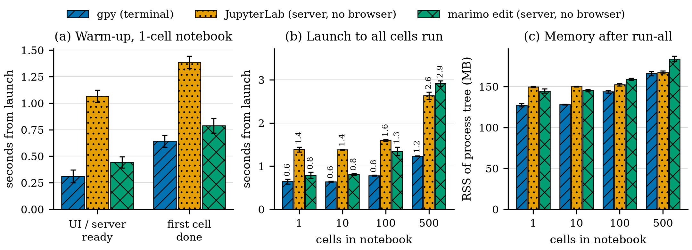

# gpython

A Python notebook in the terminal, inspired by marimo: cells know which
variables they define and use, and runs follow that graph.

Running a cell first runs the stale cells it depends on (never run, edited
since, or their inputs changed), then the cell. What happens to the cells
*below* it, the ones that use its variables, is the **run mode** (`f3`, saved):

- **lazy** (the default): they are only marked stale. You run what you want,
  when you want, without moving: `r 6` runs cell c6, `r c` this cell, `r r` the cell you ran last, `r C` the
  cells down to this one, `r a` the cells after it, `r A` all, `r s` the stale
  ones (`f4`); `r k` restarts the kernel, `r R` restarts and runs all, `r i`
  interrupts; `r t 5` times this cell over five runs and prints a bordered table
  under it (mean, median, std, variance, p50 / p90 / p99, min, max), like
  `%%timeit` (`r t` alone runs it once; `:timeit 5`).
  The same keys work in the editor's normal mode, where `space r …` is a synonym.
- **reactive**: they re-run automatically, like marimo.

**Concurrent cells** (`:set concurrent`, off by default, saved): cells of a run that share no
state run at the same time, on threads in the one kernel. A cell may join others only if neither
writes anything the other reads or writes (Bernstein's conditions); gpython works this out from
the code, counting as a write every assignment, in-place change (`xs.append`, `d[k] = v`, a
function that changes a global), call it does not know, and effect such as writing a file,
seeding `random` or drawing with `plt`. Magics, top-level `await`, `input()` and `breakpoint()`
run alone. Each cell's output, errors and `r i` still work per cell. `:groups` (or
`gpy --groups nb.py`) shows the groups and what each cell waits for; `:set concurrency=N` caps
how many run at once (1 runs them one by one). After a group, the names its cells shared are
checked: if one changed anyway, its readers are marked stale and run one by one from then on
(`:set noconcurrent_verify` turns the check off). Network calls, sleeps and NumPy run in
parallel; pure-Python loops take turns (the GIL); cells that write files run one at a time.
While a group runs, NumPy's math libraries are held to their share of the cores with
`threadpoolctl` (a gpython dependency); a kernel in a project `.venv` or conda env needs it
installed there too, or parallel NumPy cells may oversubscribe the cores.


## Performance



On a MacBook (Apple M3 Max), mean of 3 runs:
- **On screen:** gpy in 0.3 s, against 1.1 s for JupyterLab's server and 0.4 s for marimo's.
- **Run all 500 cells:** gpy in 1.2 s, against 2.6 s for JupyterLab and 2.9 s for marimo.
- **Memory:** gpy uses the least at every notebook size.

JupyterLab and marimo are timed without their browser, so their real numbers are higher. `./scripts/eval.sh` reruns the whole comparison and redraws the chart. Its files and conditions are in [`docs/benchmarks/`](docs/benchmarks/), and how gpython got here is in [`docs/optimizations.md`](docs/optimizations.md).

## Install

The package on PyPI is called `gpynb`; the command it installs is `gpython`,
with `gpy` as a short alias.
Needs Python 3.13 or newer.

```sh
uv tool install gpynb        # installs the `gpython` command globally
uv tool upgrade gpynb        # later, to update
uvx --from gpynb gpython     # or run it once without installing anything
pipx install gpynb           # if you use pipx instead of uv
```

From a checkout, `./gpython` runs the working copy (it creates the venv on
first use); `uv run gpython` does the same. To use the working copy from any
directory without root, `uv tool install --editable .` puts `gpython` and `gpy`
in `~/.local/bin` (`uv tool update-shell` adds it to `PATH`); `gpy` alone opens
an untitled scratch notebook.

## Usage

```sh
gpython                    # empty untitled notebook
gpython script.py          # a plain script is split into cells automatically
gpython a.py b.py          # several files: one tab each (gt / gT switch)
gpython notebooks/         # a directory: opens the file explorer there
gpython --no-vim nb.py     # plain editing, no modal keys
gpython --theme nord nb.py # colour theme for this run (ctrl+t picks one and remembers it)
```

Files: `.py` notebooks (plain scripts, `# %%` cells, Jupytext markdown cells),
marimo notebooks (`@app.cell`) and `.ipynb`; see [Files](#files).

## Keys

Three modes, shown in the top bar: **INSERT** (typing), **NORMAL** (vim keys in
the editor) and **CELL** (Jupyter's command mode: the whole cell is selected and
keys act on cells). `escape` goes INSERT → NORMAL → CELL; `enter` or `i` goes back
into the editor. Clicking a cell's header selects it; in cell mode any click only
selects the cell it lands on. `f1` (or `?` in cell mode)
shows every key; the list lives in `src/gpython/keymap.py`.

The editor is vim: where an app shortcut and a vim key collide, vim wins inside the
editor and the app shortcut stays in cell mode (`escape` first). The cursor is a block
coloured like the mode's badge: yellow NORMAL, green INSERT, magenta VISUAL, red
REPLACE; in cell mode the selected cell gets a blue bar and a blue block where its cursor is; the cell
being edited has a bar in the colour of the vim mode (yellow, green, purple, red, like the
badge and the cursor), a cell that needs a rerun (stale) a salmon one, and the cell the debugger is paused in a red one,
the red of the DEBUG badge (`:set cursor=bar|underline`
brings back the terminal's own cursor, coloured the same way). See
[What changed for vim](#what-changed-for-vim).

Everywhere:

| Key | Action |
|---|---|
| `shift+enter` | Run cell (markdown: render it), then go to the cell below (a new cell only on the last one) |
| `ctrl+enter` / `ctrl+shift+enter` | Run cell (markdown: render it), stay |
| `ctrl+e` | Run cell, stay — cell mode only (in the editor: vim scroll / insert-mode copy) |
| `alt+enter` | Run cell and insert a new cell below |
| `f5` / `f4` | Run all / run stale cells |
| `f6` | Python environment: switch venv/interpreter, new uv or python venv, install packages |
| `ctrl+k` | Interrupt running code |
| `ctrl+n` / `ctrl+shift+n` | New cell below (cell mode only; in the editor `ctrl+n` is vim's line down / completion) / above |
| `ctrl+d` | Delete cell, cell mode only (cells that used its variables are marked stale, or re-run when reactive; `u` undoes); in the editor it is vim's half page down / dedent |
| `alt+↑/↓`, `ctrl+↑/↓` | Previous / next cell |
| `ctrl+home` / `ctrl+end` | First / last cell |
| `alt+shift+↑/↓` | Move the cell up / down |
| `ctrl+s` / `:w` | Save (asks for a name if untitled) |
| `ctrl+b` | Toggle the file explorer (see [Files, windows and tabs](#files-windows-and-tabs)); not in vim normal / visual mode (page up) |
| `ctrl+h` / `ctrl+l` | Focus the window to the left / right; `ctrl+h` from the leftmost window opens or focuses the explorer, `ctrl+l` from the explorer goes back (not in insert mode, where `ctrl+h` is backspace) |
| `ctrl+w` … | Window commands (not in insert mode, where it deletes a word): `s` split, `v` vsplit, `h j k l` move, `q` close, `o` only, `z` zoom, `T` / `M` to tab and back, `space` window manager |
| `f1` | Help |
| `ctrl+o` | Toggle the outline panel: each cell with what it defines, live types after a run, dependency edges; `enter` jumps (cell mode; in the editor it is vim's jump back / one-shot command; `:outline`) |
| `ctrl+v` | Toggle the variables panel; it is also the debugger while a cell is paused (see [Variables and the debugger](#variables-and-the-debugger); cell mode; in the editor it is vim's visual block / literal insert; `:vars`) |
| `f3` | Toggle run mode, saved: lazy (default, cells that use the variables are only marked stale) / reactive (they re-run) |
| `ctrl+p` | Command palette: run all, restart kernel, … (cell mode; in the editor vim's line up / completion) |
| `ctrl+q` / `:q` | Quit (asks when there are unsaved changes; `:q!` does not) |

Vim normal mode (in the editor):

| Key | Action |
|---|---|
| `escape` | Leave the editor: cell mode |
| `j` / `k` | Down / up a line; past the edge moves to the next cell (`J` / `K` move cells in cell mode) |
| `J` / `gJ` | Join lines with / without a space (`3J` joins three) |
| `r<char>` / `3rx` / `r<enter>` | Replace the character under the cursor / three of them / split the line |
| `space r 6` | Run cell c6 (and `space r r c C a A s k R i d t`, as `r …` in cell mode) |
| `gg` / `G` / `3G` | First / last / third line of this cell |
| `dd` | Delete line, like vim (`3dd` three lines; `u` undoes). To delete the cell: `esc`, then `dd` |
| `.` | Repeat the last change (`3.` with a count) |
| `~` / `g~` / `gu` / `gU` | Toggle / lower / upper case: `~` one character, `gUiw` `g~w` `guu` an object, motion or line |
| `R` | Replace mode: overtype until `escape` (`backspace` restores) |
| `>>` / `<<` / `>j` / `>ip` | Indent / dedent the line, or the lines a motion or object covers |
| `==` / `=ip` / `gg=G` / `V=` | Re-indent to Python's 4-space levels: nesting follows the shape of the lines, `:` opens a level, `else`/`except` and `return` close one |
| `ma` / `` `a `` / `'a` | Set mark `a` / jump to its character / its line (`` d`a `` and `y'a` work) |
| `"ayy` / `"ap` | Named registers: `"a` before a yank, delete or put (`"A` appends, `"_` discards) |
| `qa … q` / `@a` / `@@` | Record a macro into `a`, replay it (`3@a`), repeat the last replay |
| `ctrl+a` / `ctrl+x` | Add to / subtract from the number under or after the cursor (`5 ctrl+a`) |
| `ctrl+o` (insert mode) | One normal-mode command, then back to insert mode |
| `/` | Jump: `/3` third cell (as numbered in the headers), `/text` next match after the cursor (smart case, highlighted) |
| `?` | Search backward; `n` then goes backward too |
| `n` / `N` | Next / previous match of the last search, across cells (`3n` skips three) |
| `*` / `#` / `g*` / `g#` | Search forward / backward for the word under the cursor |
| `:s/a/b/g` / `:%s` / `:.,$s` / `:'<,'>s` / `&` / `g&` | Substitute with vim patterns (`\(` `\)` `\<` `\>` `\|`) and replacements (`&`, `\1`, `\u`, `\U`, `\r`), flags `g i I n &`; `&` repeats on this line, `g&` everywhere |
| `:g/pat/cmd` / `:v/pat/cmd` | Run `d` `s` `j` `>` `<` `m` `t` `normal` on every (not) matching line; `:g/pat/` lists the lines |
| `:d` `:j` `:m0` `:t$` `:2,4>` `:normal A;` | vim line commands on a range (in cell mode `:d` deletes the cell) |
| `K` | The kernel's help for the name under the cursor (like `name?`) |
| `zc` / `za` / `zM` / `zR` | Folds are cells: hide this cell's code / every cell's code / show them all (`H` in cell mode) |
| `ctrl+d` / `ctrl+u` / `ctrl+f` / `ctrl+b` | Scroll half a page / a page; the cursor moves along within the cell |
| `ctrl+e` / `ctrl+y` / `zz` `zt` `zb` | Scroll one line / put the cursor line in the middle, top, bottom |
| `ctrl+o` / `tab` / `''` | Jump list back / forward; back to where the last jump started |
| `g;` / `g,` | Older / newer change |
| `gi` / `gI` / `gp` / `gP` / `U` | Insert where you left insert mode / at column 0; put leaving the cursor after; undo the line |
| `gq` / `gw` / `g?` | Wrap at 79 columns (comments keep `#`) / rot13, with a motion, object or doubled |
| `ctrl+v` | Visual block: `I` `A` `c` type on every line, `$` to each line's end, `d y p ~ u U r O` |
| `ZZ` / `ZQ` / `@:` | Save and close (`:x`) / close without saving / repeat the last ex command |
| `gt` / `gT` / `2gt` | Next / previous / second tab |
| `:` | Ex command |

Also `h j k l w b e ge gE W B E 0 ^ $ g_ gm | _ + - H M L % ( ) { } [( [{ ]) ]} [[ ]] [m ]m gd`,
counts (`3i` repeats the insert), `i a I A o O`, `x X s S dw d$ dj D cc cw C yy p P u ctrl+r`,
`f F t T ; ,`, text objects `iw aw iW aW ip ap is as i" a" i' a' i( a( i[ i{ i<` (`d2i(`
takes the enclosing pair), registers `"a "A "_ "0 "1-"9 "- ". "+`, `ga`, `ctrl+g`, and visual
mode `v V ctrl+v` with `o O y d c p > < = J gJ ~ u U r gq g? ctrl+a ctrl+x g ctrl+a :`.
Ranges read the notebook as one file, like vim's buffer: `%` is every line of every cell, `$`
the notebook's last line, `.,$` from here to the end of the notebook; no range is the cursor
line (in cell mode: the selected cell); a plain number is that line of the current cell, as
its gutter shows. Undo (`u`) works per cell, so undoing a `:%s` takes one `u` in each cell.

Insert mode: `ctrl+w` `ctrl+u` delete a word / to the line start, `ctrl+t` `ctrl+d` indent /
dedent, `ctrl+r x` puts register x, `ctrl+a` the last inserted text, `ctrl+e` `ctrl+y` copy
the character below / above, `ctrl+n` `ctrl+p` complete, `ctrl+v` inserts the next key
literally, `ctrl+k` and two characters types a digraph (`ctrl+k a :` ä, `:digraphs`),
`ctrl+o` runs one normal command. Not there: `d/pattern`, folds inside a cell (folds are
whole cells), `q:`, `gn`.

#### What changed for vim

| Key | In the editor now | Before | Where the old action lives |
|---|---|---|---|
| `r` | vim replace (`rx`, `3rx`, `r<enter>`) | run prefix (`r 6`, `r c`, …) | cell mode `r …`; `space r …` in the editor |
| `J` | join lines | next cell | cell mode `J` moves the cell; `j` past the last line, `ctrl+↓`, `alt+↓` |
| `K` | help for the name under the cursor | previous cell | `k` past the first line, `ctrl+↑`, `alt+↑` |
| `ctrl+k` (insert) | digraph | interrupt | other modes `ctrl+k`, `space r i`, `:interrupt` |
| `:d` (editor) | delete lines | delete cell | `:d` in cell mode, `dd` in cell mode |
| `gJ` | join without spaces (as in vim) | join with a space | `J` |
| `ctrl+d` | half page down; insert: dedent | delete cell | cell mode `ctrl+d`, `dd`, `:delete` |
| `ctrl+e` | scroll a line; insert: copy the character below | run cell | `ctrl+enter`, `shift+enter`, `alt+enter`, cell mode `ctrl+e`, `space r c` |
| `ctrl+n` / `ctrl+p` | line down / up; insert: complete | new cell / palette | cell mode, `:new`, `o` / `O` in cell mode |
| `ctrl+o` | jump back; insert: one-shot command | outline | cell mode `ctrl+o`, `:outline` |
| `ctrl+v` | visual block; insert: literal key | variables panel | cell mode `ctrl+v`, `:vars` |
| `ctrl+b` / `ctrl+f` | page up / down | explorer / nothing | cell mode `ctrl+b`, `:Ex` |
| `ctrl+w` (insert) | delete the word before the cursor | window prefix | `escape`, then `ctrl+w` |
| `ctrl+t` (insert) | indent the line | theme picker | outside insert mode, `:theme` |
| `ctrl+u` / `ctrl+y` / `tab` | half page up / scroll up / jump forward | nothing | — |
| `?` | search backward | nothing (cell mode: help) | cell mode `?` is still help |
| cursor | block, coloured by mode | bar in insert mode | `:set cursor=bar` |

Cell mode. Whether you are in cell mode or in the editor is one choice for the whole
notebook: moving across a rendered markdown or hidden-code cell (which is always
selected as a cell), deleting, undoing, searching or switching tabs keeps it; `escape`,
`enter`/`i` and a click inside an editor while editing change it.

| Key | Action |
|---|---|
| `j` / `k` (`3j`) | Select next / previous cell |
| `gg` / `G` / `3G` | Select first / last / third cell |
| `enter` / `i` | Edit the cell (normal / insert mode); on markdown, show its source |
| `a` / `b` | Insert a cell above / below |
| `dd` | Delete cell (`3dd` three; `u` brings them back) |
| `u` (or `z`) | Undo the last cell action: delete, move, insert, markdown/code switch |
| `yy` / `x` / `p` / `P` | Copy / cut / paste below / paste above |
| `J` / `K` | Move the cell down / up |
| `m` / `y` | Markdown / code cell |
| `h` | Hide / show the cell's code (marimo `hide_code`) |
| `c` / `C` | Collapse output / clear output |
| `v` | View the cell's image (a matplotlib figure) full screen (the bottom bar offers it when the selected cell has one): `+` `-` zoom, `0` fit, `1` actual size, `h j k l` pan, `n` `p` next / previous image, `s` save as PNG, `o` open in the browser, `q` closes |
| `l` | Toggle line numbers |
| `t` | Show / hide each cell's run time in its header (off by default; `:set time`, `timing = true` in the config) |
| `gt` / `gT` | Next / previous tab |
| `/` | Jump to `/3`, or select the next cell matching `/text` |
| `n` / `N` | Select the next / previous cell matching the last search |
| `escape` | Clear pending keys and the search highlight |
| `:`, `?` | Ex command, help |

Ex commands: `:w [file]`, `:wa`, `:q`, `:q!`, `:wq`, `:qa`, `:wqa`, `:e file`,
`:sp [file]`, `:vs [file]`, `:only`, `:tabnew [file]`, `:tabclose`, `:tabn`,
`:tabp`, `:ls`, `:noh`, `:Ex`, `:run`, `:timeit [n]`, `:runabove`, `:runbelow`, `:stale`, `:restart`,
`:clear`, `:s/a/b/g` (`:%s`, `:'<,'>s`, `:&&`), `:set vim|novim|lazy|nolazy|nu|nonu|time|notime|statusbar|nostatusbar|cursor=block|bar|underline`, `:set debug_detail=…`, `:vars`, `:debug`, `:stop if …`, `:md`, `:code`,
`:theme [name]`, `:N` (go to cell N), `:help`. Save and quit commands forgive caps lock:
`:Q!`, `:WQ!`, `:Wq`, `:W`, `:X`, `:QA!` work like `:q!`, `:wq!`, … (only these; `:D` is not `:d`). `:set novim`, line numbers, the
run time display, the run mode and the theme are remembered in
`~/.config/gpython/config.toml` (`vim`, `line_numbers`, `timing`, `run_mode`, `theme`, `status_bar`).

### Bottom bar

The last row shows the mode badge on the left and, on the right, modules like a tmux
status line: the clock, the host name, cpu, ram and gpu (gpu only where `nvidia-smi`
exists). All are on by default. cpu and gpu draw the last twelve samples as vertical
bars, btop style (`cpu ▂▃▅▃▂ 33%`), ram is a block meter (`ram ▪▪▪▪▪▪ 55% 14.1G/32.0G`);
every bar and number is green under 30%, yellow under 80%, red above. In the config:

```toml
status_bar = true
[status]
cpu = false
layout = "mode clock host ram"
clock_format = "%H:%M"
style = "tmux"
```

`status.<module> = false` drops a module, `status.layout` orders them (`mode clock host
cpu ram gpu` is the default), `status.clock_format` is a `strftime` pattern, `status.style
= "tmux"` draws one level glyph in brackets (`cpu [▃] 51%`) instead of the btop graphs.
`:set nostatusbar` hides the whole bar and `:set statusbar` brings it back.

Cell headers read `✓ c3 [4] 1.25s  defines x · uses y`: display position,
execution count (like Jupyter's `In [4]`) and, when `t` has turned it on, the run
time (`12ms`, `420ms`, `1.25s`, `1m 05s`).

Editing: Enter indents after `:` or an open bracket and dedents after
`return`/`pass`/…; backspace in leading whitespace removes one indent level;
Tab inserts four spaces.

`shift+enter` and `ctrl+enter` need a terminal that reports them (Ghostty,
Kitty, WezTerm, iTerm2). In Terminal.app use `alt+enter`, `space r c` in the editor,
or `escape` then `ctrl+e` / `ctrl+n` in cell mode.

Matplotlib figures and other `image/png` outputs are drawn as pictures in
terminals with the kitty graphics protocol (Kitty, Ghostty, Rex, WezTerm,
Konsole), scaled to the cell's width and at most 30 rows. Elsewhere they fall
back to Sixel or coloured half cells. `GPYTHON_KITTY_IMAGES=0` forces the
fallback. Where nothing can draw a picture, the output shows the image's size
with View (opens it in the browser) and Download (saves it as PNG) buttons. `v`
in cell mode views the figure full screen with zoom and pan; `:img save [file]`
saves it as PNG next to the notebook and `:img open` opens it in the browser.
With several images in one cell, `:img 2` views the second, `:img save 2 plot.png`
saves it, and `:img save` / `:img open` without a number take all of the cell's.
`:img save all` saves every image in the notebook (`nb-c3.png`, `nb-c5-1.png`, …)
and `:img open all` opens them all.

## Variables and the debugger

**Variables** (`ctrl+v`, `:vars`). The outline's neighbour in the right column
(when both are open, the outline is on top): one row per name the cells
defined, with its type, shape / length / dtype (`(3, 4) float64`, `len 12`),
a short value and the cell that bound it. `ctrl+w l` focuses it, then:

| key | action |
|---|---|
| `j` / `k` | Move |
| `enter` | The full value: scrollable text, or a table for a DataFrame or 2-D data (capped) |
| `g` | Go to the line of the cell that defined it |
| `d` | Delete it from the kernel (the cell becomes stale) |
| `/` | Filter by name or type |
| `a` | Hide modules, functions and classes (shown by default) |
| `q`, `escape` | Hide the panel / back to the notebook |

`input()` in a cell asks at the bottom of the screen (`escape` interrupts).

**The debugger.** `breakpoint()` in a cell pauses it and the panel turns into
the debugger (the bar says DEBUG, the paused line is lit in its cell). `r d` or
`:debug` runs the current cell paused on its first line, or, when its last run
failed, opens a post-mortem at the line that raised (the error output says so).
The panel draws the loop stack (`for i in range(n)   i=3   4/10 ████░░`, nested
loops under it), each list, tuple, string or 1-D array as a strip of boxes with
an arrow for every index the code uses on it (`nums[j + 1]` gives the arrow
`j + 1`; an index past the end is drawn after the strip in red with a warning),
2-D lists and arrays as grids with the `[i][j]` cell lit, dicts and sets with
added, removed and changed keys, and the locals with what changed since the
last stop and their earlier values (`total: 0 → 1 → 4`).

| key | action |
|---|---|
| `n` `s` `r` `c` `q` | Next line, step into, run to return, continue, quit (the cell stops) |
| `]` / `}` / `)` | Next iteration of the innermost loop / of the outer loop / run to the end of the innermost loop |
| `G` | Go to iteration N (`N L` for loop level L) |
| `b` / `B` | Stop if an expression is true (`j == len(nums) - 1`, `loss != loss`); `B` records every line on the way (`:stop if …`) |
| `h` / `l` | Back / forward through the recorded moments: time travel over what already ran |
| `T` | Timeline: one row per iteration, inner loops nested (`l` / `h` open and close them), changed values, ⚠ where an index was out of range |
| `u` / `d` | Up / down the stack |
| `w`, `e`, `enter` | Watch an expression, any pdb command, the full value of a local |

How much is recorded is one setting, `debug_detail`, saved in the config and
set with `:set debug_detail=…` (it applies to the next recording):
`full` (the default) keeps every step with every value, up to 200 MB; `auto`
is full until a recording passes 10,000 steps, then balanced (the footer says
`auto → balanced`); `balanced`
keeps changes only, with a keyframe every 100 steps, and thins old iterations
(every line of the last three, one moment per older iteration, then every 10th
and every 100th), up to 20 MB; `lean` keeps only the loop positions and watched
names, up to 5 MB. Each limit has its own key that overrides the preset:
`debug_history` (`20MB`, `1GB`), `debug_events`, `debug_thinning=on|off`,
`debug_repr_chars`, `debug_strip_items`, `debug_grid_size` and
`debug_stats=watched|cpu|off` (`cpu` adds stats for small arrays on the CPU);
`:set debug_history?` says what is in effect and
where it comes from. The footer shows `full · 1,240 steps · 3.1 MB / 200 MB`.
In every preset tensors and arrays are summarised by type, shape, dtype and
device (no GPU sync), also inside lists; their strips show the pointers but no
values; watched ones also get their values, mean, min, max and the NaN count.
Stepping into library code with `s` records those steps too, shown as
`file.py:12 in f()`.
pdb breakpoints (`e` then `b 12`) are underlined in the cell and stop `]`, `}`,
`)` and stop-if too.
Nothing is installed while no cell is paused, so a normal run costs nothing.

## Markdown cells

A markdown cell shows rendered text (headings, lists, code, links) instead of an
editor, and it never runs.

- Make one: `ctrl+n` for a new cell, then `escape escape` (cell mode; one `escape` with `--no-vim`) and `m`. Or type
  `:md` in any cell. `y` or `:code` turns it back into code. Turning a code cell
  into markdown removes its variables, so the cells that used them are marked
  stale (reactive mode re-runs them, and they fail).
- Edit: select the cell and press `enter` (or `i`), or double-click it.
- Render: `escape escape` (back to cell mode), `shift+enter` (render and go to
  the next cell), `ctrl+enter` (render and stay), or just move to another cell.
- Files: in `.py` notebooks a markdown cell is `# %% [markdown]` followed by
  lines starting with `# ` (the Jupytext format). In plain scripts without
  markers, a top-level `"""text"""` string is a markdown cell. `.ipynb`
  markdown cells load and save as markdown cells.

A code cell whose last line is a bare string (`"""note"""`) does not print
that string as its result.

## Files, windows and tabs

gpython opens several notebooks at once, the way vim opens several files:
each notebook is a *window*, windows can be split, and tabs group windows.
Every notebook has its own kernel (its own variables, its own `__file__`).

**File explorer** (`ctrl+b`, `:Ex`, `:e` with no name). A tree of the
notebook's folder on the left: folders and `.py`/`.ipynb` files, hidden files
and other extensions behind `.`. Keys inside it:

| Key | Action |
|---|---|
| `j` / `k`, `gg` / `G` | Move |
| `h` / `l` | Collapse (or go to the parent) / expand a folder; `l` on a file opens it |
| `enter` / `o` / `t` | Open the file in its own tab (a folder expands); a blank untitled window is reused |
| `e` | Open the file in the current window (like `:e`) |
| `s` / `v` | Open in a horizontal / vertical split |
| `-` | Go up: the parent folder becomes the root |
| `C` | Make the folder under the cursor the root |
| `%` | New notebook in the folder under the cursor |
| `/`, `n` | Search file names, repeat |
| `.` | Show hidden and non-notebook files |
| `R` | Reload |
| `q`, `escape`, `ctrl+b` | Hide the explorer |

**Outline** (`ctrl+o`, `:outline`, `:tags`). The explorer's twin on the right:
one node per cell (`c2  defines np, xs`, a markdown cell shows its heading),
expandable to the names it defines: imports, variables, functions with their
signature, classes. Once a cell has run, variables show the kernel's type and
value (`xs  list  [1, 2, 3]`). The cursor follows you: the current cell, or
the function or class whose lines hold the editor cursor, like tagbar. A
footer shows the cell's edges in the dependency graph (`← uses c1, c2   →
used by c4`). `ctrl+w l` from the rightmost window focuses it, then:

| key | action |
|---|---|
| `j` / `k` | Move through the cells and their definitions |
| `enter` | Jump: a cell selects it, a definition opens the cell's editor on that line |
| `h` / `l` | Collapse / expand a cell |
| `q` | Hide the outline and go back to the notebook |
| `escape`, `ctrl+w h` | Back to the notebook, the outline stays |

It replaces the old f2 variables table. In insert mode `ctrl+o` keeps vim's
meaning (one normal-mode command); use `:outline` there.

`ctrl+b` toggles the explorer from anywhere. The explorer stays open after a
file is opened; `ctrl+h` or `ctrl+w h` from the leftmost window (or `ctrl+w w`)
goes back to it, and `ctrl+l` returns to the notebook. Terminals send `ctrl+h`
as backspace, so backspace does the same outside insert mode. A file that is
already open is shown (its tab focused) instead of being opened twice. Clicking
a file opens it too.

**Windows** (`ctrl+w` then a key, as in vim; not in insert mode, where
`ctrl+w` deletes a word):

| Key | Action |
|---|---|
| `ctrl+w s` / `:sp [file]` | Split: a new window below (an untitled notebook, or `file`) |
| `ctrl+w v` / `:vs [file]` | Vertical split: a new window to the right |
| `ctrl+w h` `j` `k` `l` | Focus the window to the left / below / above / right |
| `ctrl+w w` / `ctrl+w p` | Next / previous window (the explorer counts as the first) |
| `ctrl+w q` / `:q` | Close this window (asks if unsaved; closing the last one quits) |
| `ctrl+w o` / `:only` | Keep only this window |
| `ctrl+w T` | Move this window to a new tab |
| `ctrl+w M` / `:tabmerge` | The reverse: put the window back where `T` took it from (else into the previous tab) |
| `ctrl+w z` / `:zoom` | Zoom: the window fills the tab; again brings the splits back (like tmux's prefix z) |
| `ctrl+w x` | Swap this window with the next one in its row or column |
| `ctrl+w r` / `R` | Rotate the windows of this row or column forward / back |
| `ctrl+w H` `J` `K` `L` | Move the window to the far left / bottom / top / right, full height or width (turns side-by-side into stacked and back) |
| `ctrl+w space` / `:windows` | The window manager (below) |
| `ctrl+w =`, `+` `-` `<` `>` | Equalize / resize |

Moving to another window, splitting or closing undoes a zoom. While zoomed, the
status line says so and the tab line marks the tab with `⤢`.

**Window manager** (`ctrl+w space` or `:windows`): a floating list of every
tab, the windows in each, and the hidden buffers, with a map of the selected
tab's layout and what the selected notebook is (path, kernel, unsaved). The keys
are printed at the bottom of the popup:

| Key | Action |
|---|---|
| `j` `k` / arrows, `g` `G`, click | Move (click the selected row, or double-click, to go there) |
| `enter` | Go there: a tab, a window, or show a hidden buffer in the current window |
| `s` / `v` | Put the selected notebook in a split below / beside the window you came from (it moves from another tab, or a hidden buffer is shown) |
| `t` | Give it a tab of its own |
| `z` | Go there and zoom it |
| `x` | Close its window (or a whole tab); the notebook stays a hidden buffer |
| `d` / `D` | Delete the buffer and stop its kernel (`D` even when unsaved) |
| `J` / `K` | Move its tab right / left (`:tabmove N` does the same) |
| `1`-`9` | Go to that tab |
| `/` | Filter by name; `esc` clears the filter, `esc` again closes |

When a tab has several windows each shows a status line with its file name,
dirty mark and kernel state; the active window's line is highlighted.

**Tabs**: `:tabnew [file]`, `gt` / `gT` / `2gt` (normal and cell mode),
`:tabn`, `:tabp`, `:tabclose`, `:tabonly`, `:tabmove N`. The tab line appears above the
notebook once there are two tabs (or a hidden buffer, see below); click a tab
to switch. `gpython a.py b.py` opens one tab per file.

**Buffers** (as in vim): every opened notebook is a buffer with its own
kernel, numbered in opening order. Closing a window (`:q`, `ctrl+w q`,
`:tabclose`) only hides its notebook: variables and outputs stay, and the tab
line lists hidden buffers (click one to show it).

| Command | Action |
|---|---|
| `:ls` / `:buffers` | List buffers: `%a` current, `a` shown, `h` hidden, `+` unsaved |
| `:b N` / `:b name` | Show that buffer in the current window (a partial, unique name works) |
| `:bn` / `:bp` | Next / previous buffer in the current window |
| `:bd [N]` | Delete the buffer and stop its kernel (asks if unsaved; `:bd!` does not) |
| `:e file` | Open a file in the current window (refuses if unsaved; `:e! file` discards) |

`:w` saves the current notebook, `:wa` saves every buffer, `:q` on the last
window quits (asking about any unsaved buffer), `:qa` quits, `:wqa` saves
everything and quits. Hidden buffers keep their kernel process alive; `:bd`
frees it.

## Themes

`ctrl+t` opens a theme picker with live preview: move through the list and
the whole notebook (editor syntax colours included) changes as you go;
`enter` keeps the theme and writes it to `~/.config/gpython/config.toml`,
`escape` restores the one you had. Every later session starts in the saved
theme. `:theme name` does the same without the picker and is saved too;
`--theme name` applies to that run only; `:theme` alone shows the current one.

The default theme, `terminal` (also `:theme default`), uses your terminal's
own colours and background, so gpython looks like whatever colorscheme the
terminal has. Syntax colours are the terminal's 16 named colours.

Themes: terminal, catppuccin (mocha, macchiato, frappe, latte), gruvbox (dark, light),
material (oceanic, palenight, darker, lighter), nord, dracula, tokyo-night,
solarized (dark, light), monokai, plus Textual's built-in themes.

## Python environments and packages

Each notebook's kernel runs in a Python environment. The header chip shows
which one (`● Python 3.12.4 · .venv ▾`); its dot is the kernel state (green
ready, yellow starting or installing, red failed) and while the kernel is not
ready the state text, such as the live output of a running install, follows
the environment name.

At start a notebook uses the environment it last used; otherwise the nearest
`.venv` / `venv` (next to the file, up to the project root) that has
ipykernel; otherwise gpython's own interpreter. A project venv without
ipykernel is pointed out once.

`f6` (or a click on the header chip) opens the environment picker:

- **Switch**: every venv, uv env and conda env next to the notebook and in
  `~/.virtualenvs`, `~/.venvs`, conda's `envs`, plus uv's managed Pythons and
  `python3.x` on `PATH`. Type to filter, or type a path to a venv or a python.
  Picking a venv without ipykernel installs it first. Picking a bare
  interpreter offers to make a venv from it. Switching starts a fresh kernel
  (cells become stale) and is remembered for that notebook.
- **New uv env**: `uv venv <folder> [--python 3.12]`, then ipykernel, then
  switch. Any Python version uv can download works.
- **New venv**: the same with `python -m venv` and pip, no uv needed.
- **Install packages**: `uv pip install` into the kernel's environment (pip
  without uv). New imports work without restarting the kernel.
- **Add to project**: `uv add`, writing to `pyproject.toml` and syncing into
  the kernel's environment.

The same as commands: `:env` (picker) or `:env name|path`, `:venv [folder]
[python]`, `:uv venv [folder] [python]`, `:pip numpy pandas`, `:pip list`,
`:pip uninstall x`, `:uv add httpx`, `:uv <anything>` (runs in the project).
Inside cells, `%uv pip install x` and `%uv add x` target the kernel's own
interpreter, and `%pip` uses uv in environments that have no pip.

**Missing modules.** When a cell fails with `ModuleNotFoundError`, the install
prompt opens at the bottom, prefilled with the package (`cv2` becomes
`opencv-python`, `sklearn` becomes `scikit-learn`, `from google.cloud import
storage` becomes `google-cloud-storage`; the table is `packages.json`, anything
else installs under its import name). The prompt lists how: `uv add` (into
`pyproject.toml`, synced into the env) when the project has one, and
`uv pip install` (the env only; plain pip without uv). `↑`/`↓` pick: the
chosen row carries `●` and the title shows the exact command `enter` will
run. The pick is remembered as `install_mode`; until you pick `uv add` once,
the default is `uv pip install`, which touches no project file. `enter`
installs and runs the cell again;
`esc` declines. A failed install shows the exact command, its exit code and
what uv or pip said, both as a notification and under the cell. A hint under
the traceback keeps the `:pip` command, and `:pip` alone offers the same package.
Running the cell again asks again; only the automatic re-run after an install
leaves out a module that still fails. `:set autoinstall` installs and re-runs
without asking (a failed install asks on the next run); `:set noautoinstall`
goes back to the prompt.
Standard-library modules the interpreter was built without are pointed out
instead.

## Rules (same as marimo)

- A name may be defined in only one cell. Repeating the identical import
  (`import seaborn as sns` in two cells) is allowed; the first cell owns the name.
- Names starting with `_` are private to their cell.
- In-place changes (`xs.append(1)`, `d["k"] = v`) at a cell's top level are
  tracked: readers below run after the mutator, and running the mutator first
  re-runs the cell that created the object so it starts fresh.

## Files

Notebooks are plain `.py` files. `# %%` markers (VS Code / Jupytext) are
honoured; files without markers are split at top-level statements and saved
back without markers, so a script stays a script. `__file__` and the working
directory match the notebook, like running it as a script.

**marimo notebooks** (`import marimo as mo` … `@app.cell` functions) open as
cells and save back byte-identical when nothing changed: cell names, the
`hide_code=True` decorator argument (such cells open with their code hidden;
`h` in cell mode shows it) and `mo.md(...)` cells are kept. In the
kernel a small `marimo` shim provides `mo.md`, `mo.Html`, `mo.hstack`,
`mo.vstack` and `mo.ui` placeholders so such notebooks run. Not kept: other
decorator arguments and comments after a cell's `return`.

**Jupyter notebooks** (`.ipynb`) open with their code and markdown cells,
their stored outputs and execution counts, and save back as `.ipynb` with the
current outputs (notebook metadata preserved).

## Layout

`graph.py` dependency analysis · `kernel.py` IPython kernel in a subprocess
via jupyter_client · `notebook.py` file formats (`# %%`, scripts, marimo,
`.ipynb`) · `vim.py` modal editor and completion popup · `cell.py` one cell ·
`pane.py` one notebook window · `windows.py` tabs and split layout ·
`explorer.py` file tree · `themes.py` / `themepicker.py` / `config.py` ·
`outputs.py` rich outputs · `images.py` kitty graphics placements · `keymap.py` the key table (help and this README) ·
`variables.py` / `debugview.py` the variables panel and the debugger's pictures · `kernel_side.py` the debugger inside the kernel ·
`app.py` + `app.tcss` the Textual app.

```sh
uv run pytest -q
```

Releases go through a reviewed pull request:

1. From an up-to-date `main`, branch `release/X.Y.Z`.
2. In `CHANGELOG.md`, move `[Unreleased]` entries under `## [X.Y.Z] - YYYY-MM-DD`, fill in
   anything merged without an entry, and add the compare link at the bottom.
3. Bump `version` in `pyproject.toml`, run `uv lock` and `uv run pytest -q`.
4. Commit `Release X.Y.Z: <summary>`, push, open a PR titled `Release X.Y.Z` and ask the
   other maintainer to review it.
5. After the merge, tag the merge commit on `main` and push the tag:
   `git switch main && git pull && git tag vX.Y.Z && git push origin vX.Y.Z`.

The tag runs `.github/workflows/publish.yml`: it builds, uploads to PyPI through trusted
publishing, and creates the GitHub release with the wheel and sdist attached and that
changelog section as its notes. It fails if the changelog has no section for the version.
