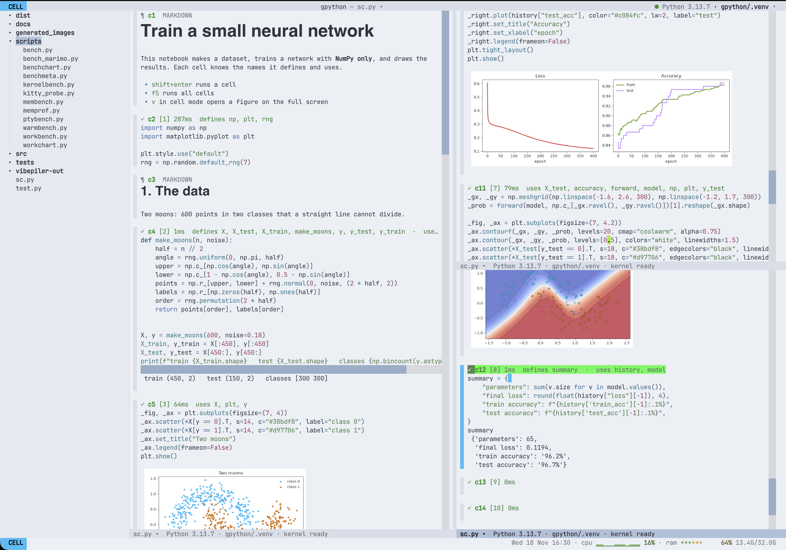
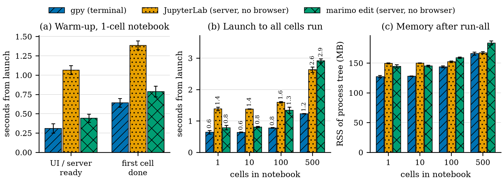

<h1 align="center">
  <picture>
    <source media="(prefers-color-scheme: dark)" srcset="docs/images/gpython-logo-dark.svg">
    <source media="(prefers-color-scheme: light)" srcset="docs/images/gpython-logo-light.svg">
    
  </picture>
</h1>

A Python notebook in the terminal, inspired by [marimo](https://github.com/marimo-team/marimo):
cells know which variables they define and use, and runs follow that graph.

<picture>
  <source media="(prefers-color-scheme: dark)" srcset="docs/images/screenshot-dark.png">
  <source media="(prefers-color-scheme: light)" srcset="docs/images/screenshot-light.png">
  
</picture>

## Performance



On a MacBook (Apple M3 Max), mean of 3 runs:
- **On screen:** gpy in 0.3 s, against 1.1 s for JupyterLab's server and 0.4 s for marimo's.
- **Run all 500 cells:** gpy in 1.2 s, against 2.6 s for JupyterLab and 2.9 s for marimo.
- **Memory:** gpy uses the least at every notebook size.

JupyterLab and marimo are timed without their browser, so their real numbers are higher. `./scripts/eval.sh` reruns the whole comparison and redraws the chart. Its files and conditions are in [`docs/benchmarks/`](docs/benchmarks/), and how gpython got here is in [`docs/optimizations.md`](docs/optimizations.md).

## Install

The package on PyPI is called `gpynb`; the command it installs is `gpython`,
with `gpy` as a short alias.
Needs Python 3.13 or newer.

```sh
uv tool install gpynb        # installs the `gpython` command globally
gpython --update             # later, to get the newest release (--update dev: the newest code on GitHub)
uvx --from gpynb gpython     # or run it once without installing anything
pipx install gpynb           # if you use pipx instead of uv
```

Then turn on tab completion in your shell (bash, zsh, fish or PowerShell), once:

```sh
gpy --install-completions    # gpy --th + tab gives --theme; run it again after an upgrade
```

It writes one script under `~/.config` and adds one line to your shell's start-up
file (`~/.zshrc`, `~/.bashrc` or the PowerShell profile; fish needs no line). Open a
new terminal to use it. `gpy --completions zsh` prints the script if you want to
place it yourself.

From a checkout, `./gpython` runs the working copy (it creates the venv on
first use); `uv run gpython` does the same. To use the working copy from any
directory without root, `uv tool install --editable .` puts `gpython` and `gpy`
in `~/.local/bin` (`uv tool update-shell` adds it to `PATH`); `gpy` alone opens
an untitled scratch notebook.

## Usage

```sh
gpython                    # empty untitled notebook
gpython script.py          # a plain script is split into cells automatically
gpython a.py b.py          # several files: one tab each (gt / gT switch)
gpython notebooks/         # a directory: opens the file explorer there
gpy script.py              # gpy is a short alias for gpython; every form above works with it
```

More options are on the [Command line](https://github.com/igaurab/gpython/wiki/Command-line) page.

## Agents

`:agent` opens a panel with a coding agent beside the notebook. The agent reads, changes and
runs the cells on your kernel, and sees the same variables you do.

```
:agent              show or hide the panel (the first time starts the agent)
:agent codex        claude · codex · opencode · gemini · pi, or a name from the config
:agent new          a new conversation
:agent link         let an agent in another terminal use the notebook
```

The agent must be installed and logged in already; gpython only starts it. Claude Code, Codex
and pi are reached through a small adapter that `npx` gets on first use. Any program that
speaks the [Agent Client Protocol](https://agentclientprotocol.com) can be added in
`~/.config/gpython/config.toml`:

```toml
agent = "codex"

[agents]
mine = "my-agent --acp"
```

An agent in its own terminal gets the same notebook tools from `gpython mcp`
(`claude mcp add gpython -- gpython mcp`, after `:agent link` in gpython).

## Documentation

The full documentation is in the [wiki](https://github.com/igaurab/gpython/wiki):

- [Command line](https://github.com/igaurab/gpython/wiki/Command-line): every option, such as `--no-vim` and `--theme`
- [Running cells](https://github.com/igaurab/gpython/wiki/Running-cells): run modes, the `r …` run keys, concurrent cells, the rules
- [Keys](https://github.com/igaurab/gpython/wiki/Keys) and [Vim](https://github.com/igaurab/gpython/wiki/Vim): every key and ex command
- [Variables and the debugger](https://github.com/igaurab/gpython/wiki/Variables-and-the-debugger)
- [Markdown cells](https://github.com/igaurab/gpython/wiki/Markdown-cells)
- [Files, windows and tabs](https://github.com/igaurab/gpython/wiki/Files-windows-and-tabs): explorer, outline, splits, buffers
- [Python environments](https://github.com/igaurab/gpython/wiki/Python-environments): venvs, uv, installing packages
- [Images](https://github.com/igaurab/gpython/wiki/Images): figures in the terminal
- [Themes and status bar](https://github.com/igaurab/gpython/wiki/Themes-and-status-bar)
- [Configuration](https://github.com/igaurab/gpython/wiki/Configuration): every setting, such as concurrent cells and the run mode
- [File formats](https://github.com/igaurab/gpython/wiki/File-formats): scripts, `# %%`, marimo, `.ipynb`
- [Development](https://github.com/igaurab/gpython/wiki/Development): source layout, tests, releases
