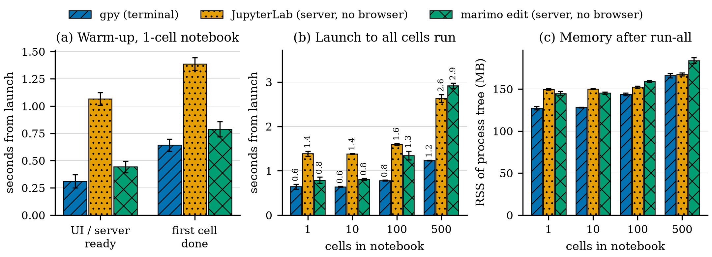
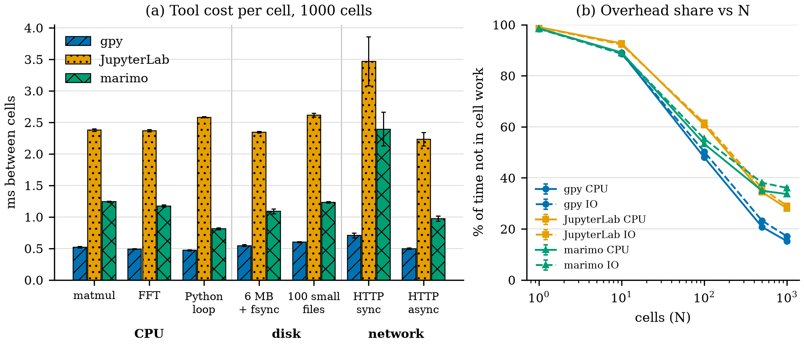
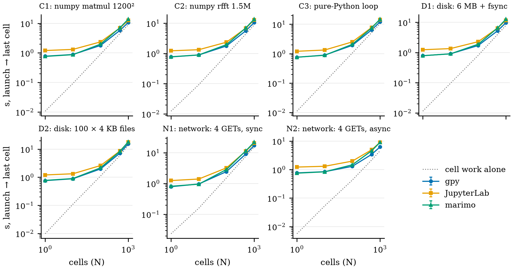

# Benchmarks: gpy vs JupyterLab vs marimo

Everything in this folder is generated by one command, run from the repo root on an idle machine:

```
./scripts/eval.sh              # RUNS=5 ./scripts/eval.sh for more runs; ./scripts/eval.sh OUT_DIR to write elsewhere
```



| file | what it holds | made by |
|---|---|---|
| `meta.json` | commit, date, CPU, cores, memory, OS, Python, tool versions, load average at start | `scripts/benchmeta.py` |
| `warmbench.json` | every run: launch → ready, first cell, last cell, memory, at 1/10/100/500 cells | `scripts/warmbench.py` |
| `kernelbench.json` | kernel start, round trip, stream, rich output, interrupt: raw jupyter_client, gpy, jupyter_server | `scripts/kernelbench.py` |
| `warmup_scaling.png` / `.pdf` | the figure above (300 dpi PNG; PDF with embedded fonts for papers) | `scripts/benchchart.py` |

How each tool is driven:
- **gpy** runs in a real pseudo-terminal, with F5 pressed at the first frame.
- **JupyterLab** gets a kernel over REST and all cells over the kernel WebSocket.
- **marimo** gets what its browser page sends: server token, session WebSocket, instantiate.

Each cell appends a timestamp to a marker file, so the times come from the kernel itself. The browser is not counted for JupyterLab or marimo, so their real numbers are higher. Error bars are ±1 sample std over the runs. The colours are Okabe–Ito (colour-blind safe), with a hatch per tool.

What the numbers mean, and how gpython got them: [`../optimizations.md`](../optimizations.md).

## Workload scaling: CPU-bound and IO-bound notebooks

```
./scripts/workeval.sh          # about 45 min; RUNS=3 for a quicker pass
```





Seven problems of about 10 ms of real work per cell, 1 to 1000 work cells after one setup cell, 5 runs,
the tool order shuffled in each run. All three kernels run in one interpreter (`~/.cache/gpython-workbench-env`,
checked per run) with BLAS pinned to one thread. Design and hypotheses: [`../plans/13-workload-eval.md`](../plans/13-workload-eval.md).

| id | domain | per cell |
|---|---|---|
| C1 | CPU | numpy matmul 1200 × 1200 |
| C2 | CPU | numpy rfft of 1.5M + reduction |
| C3 | CPU | pure-Python sum of squares (holds the GIL) |
| D1 | disk | write 6 MB, fsync, read back, hash |
| D2 | disk | write and read 100 × 4 KB files |
| N1 | network | 4 sequential GETs of 64 KB from a local server with 2 ms delay |
| N2 | network | the same 4 GETs with top-level `await asyncio.gather` |

| file | what it holds | made by |
|---|---|---|
| `workmeta.json` | machine, versions, load | `scripts/benchmeta.py` |
| `workbench.json` | every run: ready, last, span, work_ms, gap_ms, memory | `scripts/workbench.py` |
| `workbench_before_sortfix.json` | the same sweep before `Graph.sort` became a heap | `scripts/workbench.py` |
| `workload_scaling*.png` / `.pdf` | the figures above | `scripts/workchart.py` |

`gap_ms` is the idle time between one work cell ending and the next starting, read from the kernel's own clock:
the tool's cost per cell, with the user's work taken out.
